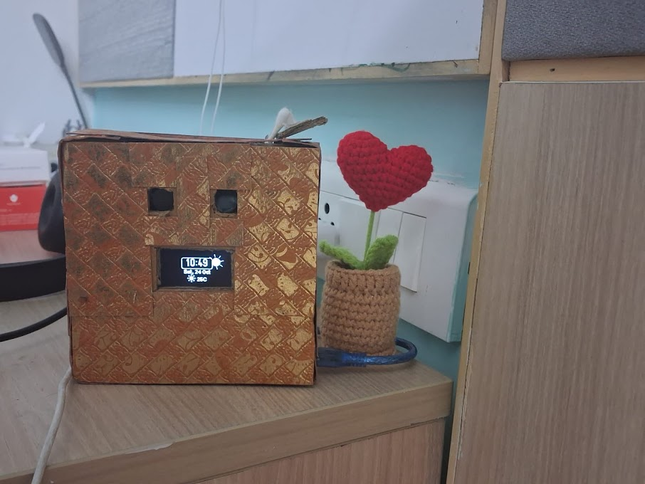
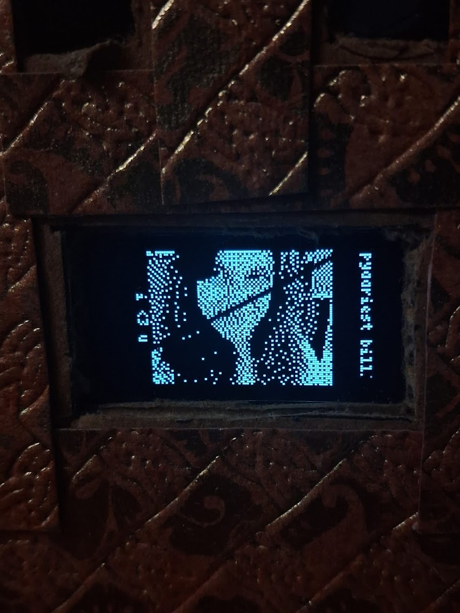
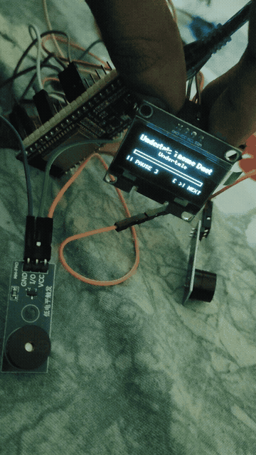
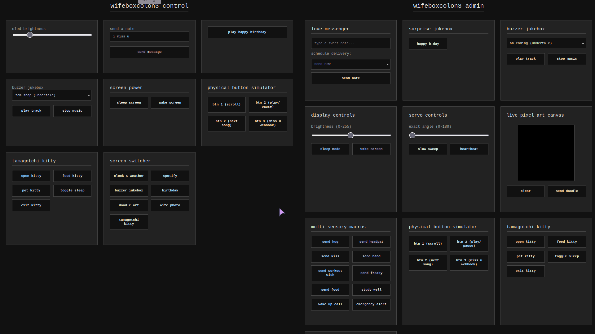
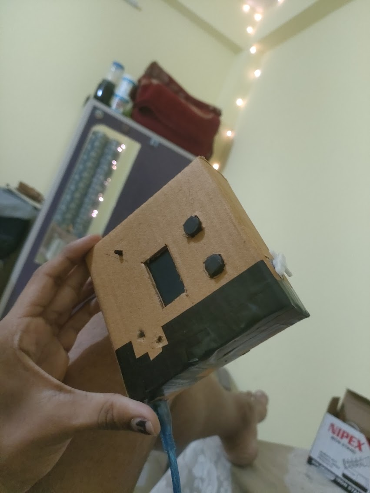
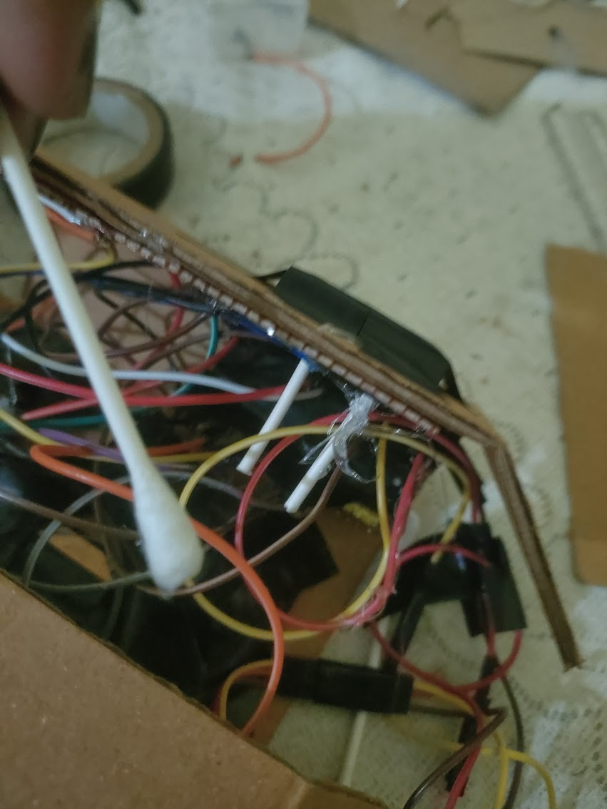
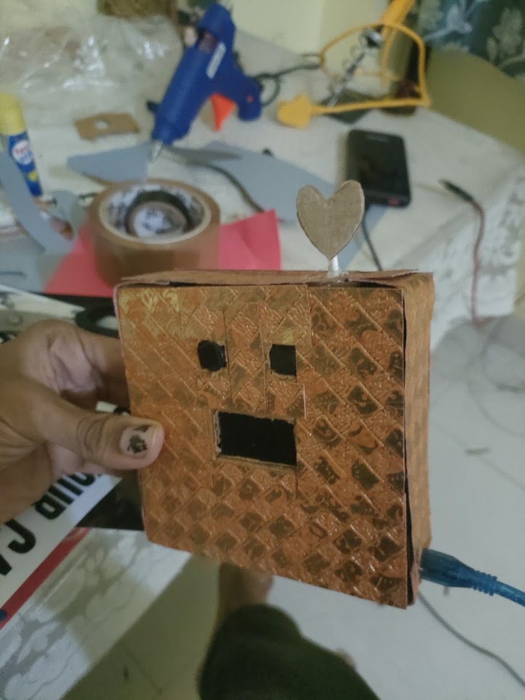
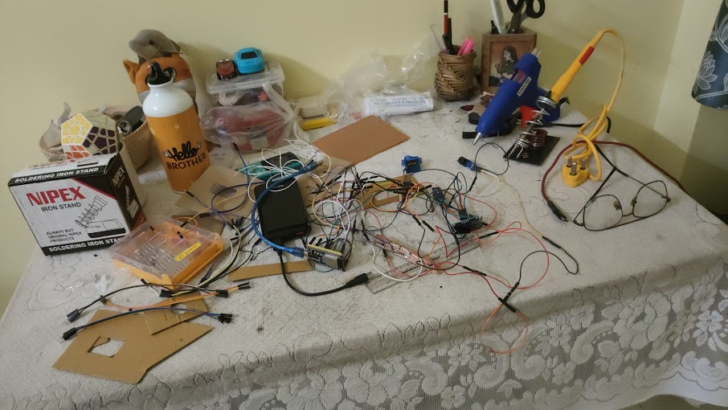
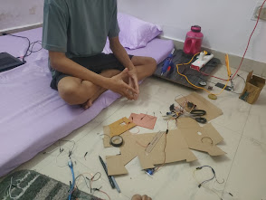
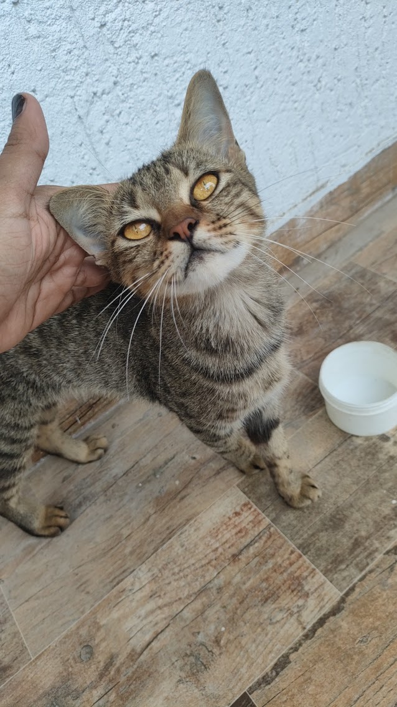

## wifebox

```diff
+ > husband love wife
+ > wife far away :c
+ > husband make wifebox for wife on her birthday
+ > husband send wifebox with love
+ > wife happy
+ > husband semi-happy (parcel broke the servo)
+ > :3
```

## process
started as a solution to my wife being able to stalk my spotify whenever she wants to, turned into a 24/7 tabletop idle clock / weather / spotify stalking / tamagotchi kitty / wife and husband photo display / doodle sharing / love sharing thingmabob doohickey.

i did not have much experience with electronics before making this, it was fun learning how all of it works, especially the hardware part.

i have used an LLM to assist me in some parts of the code which was very complex for me, especially the doodle and music conversions to display and sound respectively

## features
- **live clock & weather**: shows current time, date, and live weather/temperature so she knows what it's like outside.
- **spotify stalking**:
  - **now playing**: live track name, artist, and progress bar so she always knows what i'm listening to.
  - **recently played**: lets her scroll through my last 20 played songs when i'm not actively playing anything.
- **dual-buzzer 8-bit music player**: two buzzers harmonizing chiptune songs (undertale, jojo, birthday tunes) with dancing screen visualizer.
- **tamagotchi kitty**: an interactive pixel cat she can hug, kiss, headpat, hold hands with, feed, study with, and tuck into bed.
- **sweet photos**: dithered monochrome photos of her and me with cute vertical text down the sides.
- **live doodle board**: a web drawing board where we can sketch pixel art and have it pop up live on the display.
- **"i miss you" button**: physical button on the box that pings her phone with a notification, plus lets her send back custom messages to the screen.
- **web remotes**: local and vercel web controllers to trigger songs, kitty moods, and screen switches from anywhere.
- **interactive animation macros**: one-tap buttons on the web remote that play cute little animated scenes on the screen (hugs, kisses, headpats, holding hands, study sessions, workouts, and snacks).
- **birthday surprise mode**: a celebration sequence with an animated cake, flickering candles, and a birthday song.
- **display brightness control**: slider on the web remote to dim the oled at night so it doesn't blind her in the dark.
- **servo motor heart waver**: a little servo controlled heart on the box that physically waves when special alerts or notifications arrive.
- **hotspot auto-reconnect**: rescans in the background for her phone hotspot when she walks into the room so she doesn't have to restart the box.

## how it looks

#### idle screen showing live clock, date, and weather


#### wife's lovely photo


#### dual-buzzer 8-bit undertale player demo


#### web controller dashboard


#### cardboard enclosure with electric tape


#### dubious internal cable management crammed into the box


#### fully assembled wifebox with screen and input buttons


#### workbench chaos during assembly and soldering


---

### special thanks
thank you sarthak and bawandurr for helping me alot




---

i love you humesha wife ji :3


